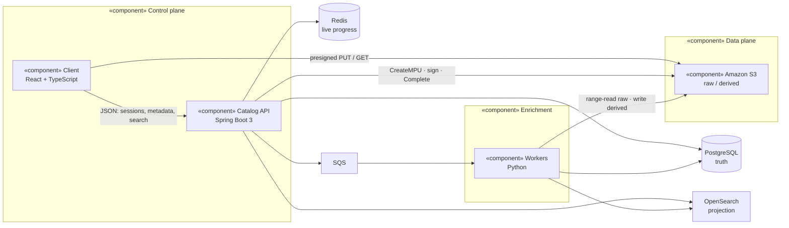
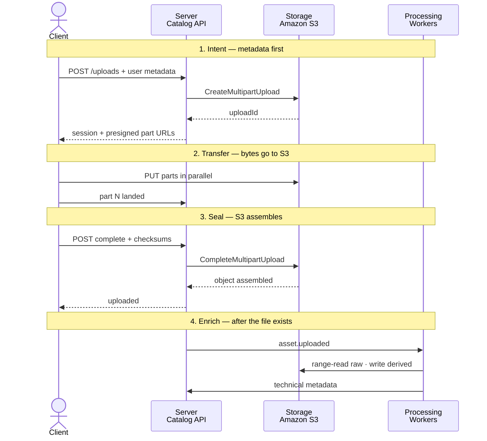
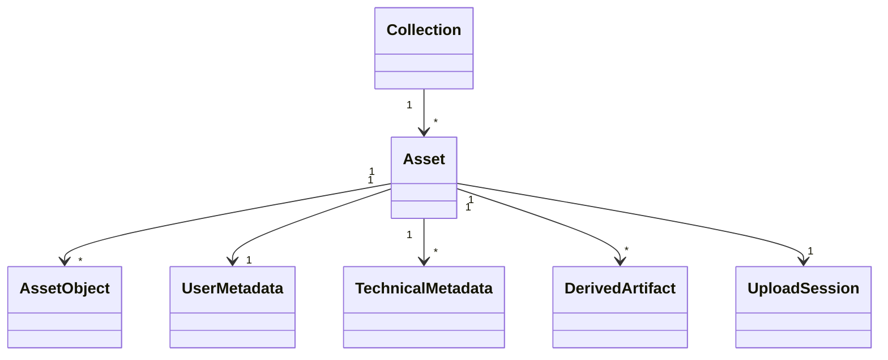
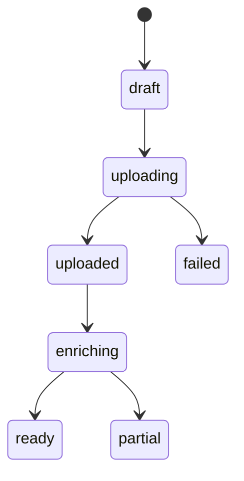
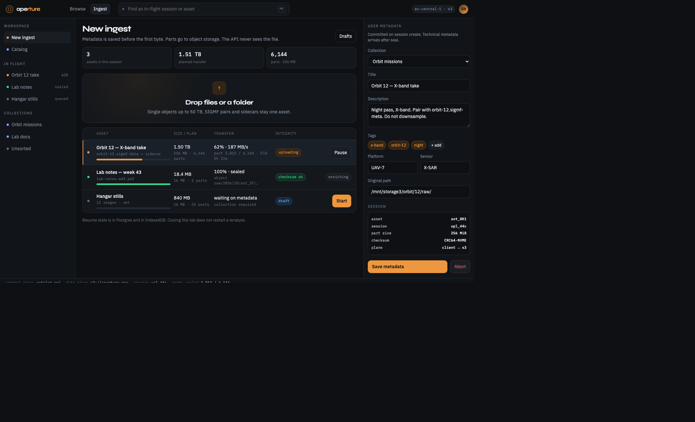
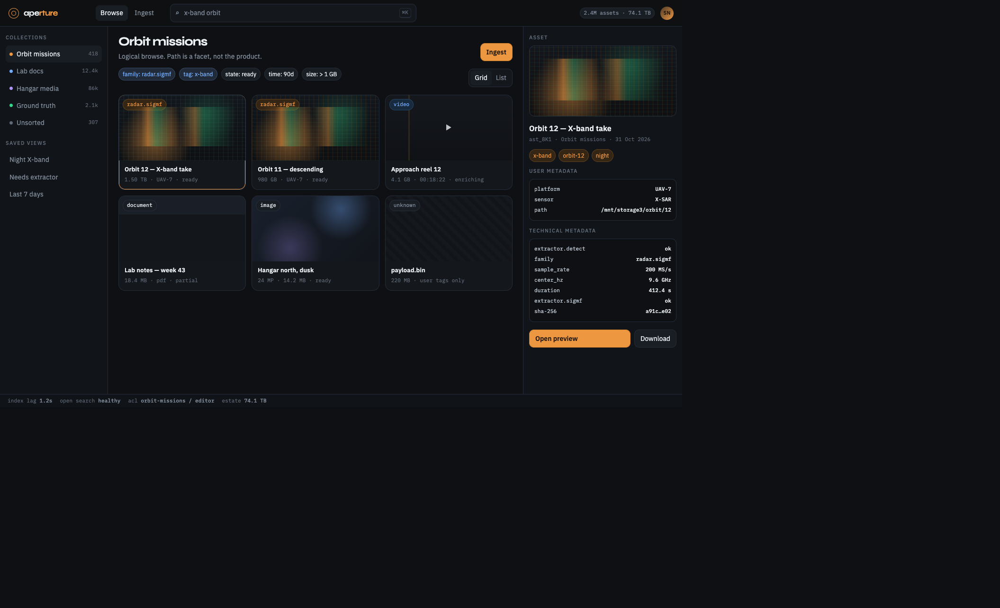

# Aperture

A catalog and ingest plane for tens of terabytes of highly diverse files — documents, images, video, radar, and formats we do not know yet.

This repository is the system design: architecture, tool choices, technical decisions, and high-fidelity UI for upload and browse. The screens are visual mockups. They are not wired to a backend.

Open the UI locally:

UML lives in the repo, not only in HTML:

- English: [`docs/uml.md`](docs/uml.md)
- Hebrew: [`docs/uml.he.md`](docs/uml.he.md)
- Interactive EN / עב: [`ui/uml.html`](ui/uml.html)
- Presentation slides: [`ui/present.html`](ui/present.html) · notes [`docs/present.md`](docs/present.md) / [`docs/present.he.md`](docs/present.he.md)
- One-file pipeline (what each DB holds at each step): [`ui/pipeline.html`](ui/pipeline.html) · [`docs/pipeline.md`](docs/pipeline.md) / [`docs/pipeline.he.md`](docs/pipeline.he.md)

```bash
open ui/present.html
open ui/uml.html
open ui/upload.html
open ui/browse.html
```

Or serve the folder:

```bash
python3 -m http.server 4173 --directory ui
```

Then visit [http://localhost:4173/uml.html](http://localhost:4173/uml.html), [upload](http://localhost:4173/upload.html), and [browse](http://localhost:4173/browse.html).

---

## The problem

Storage already holds tens of terabytes. It keeps growing. The files are not one type and they are not organized in a way people can actually browse.

The system has to do four things well:

1. **Accept uploads that can be terabytes**, over networks that drop, laptops that sleep, and sessions that last hours.
2. **Take user metadata at ingest time**, before the file is even fully on disk.
3. **Enrich each file automatically** with technical metadata whenever a parser exists.
4. **Let people find files logically** — by collection, type, time, tag, mission, sensor — not by walking a raw filesystem.

Bytes and meaning have to be separated. The object store holds bytes. The catalog holds meaning. If those two are mixed, the system does not scale.

---

## Architecture

The control plane never carries file bytes. The client talks to **Catalog API** for sessions, metadata, search, and permissions. The client talks to **object storage** for the actual upload and download. After an object is complete, a queue wakes **enrichment workers**. Workers read the object, write derived artifacts back to storage, and update the catalog.

Full UML (component, sequence, class, state) is in [`docs/uml.md`](docs/uml.md) and [`docs/uml.he.md`](docs/uml.he.md).









| Component | Role | What lives there |
|---|---|---|
| **Client** | Ingest UI, browse UI, upload engine | Local resume state, selected metadata, part checksums in flight |
| **Catalog API** | Control plane | Upload sessions, asset records, authz, search queries, presigned URLs |
| **PostgreSQL** | Source of truth | Assets, user metadata, technical metadata, collections, job state |
| **Redis** | Fast ephemeral state | Session locks, rate limits, live upload progress |
| **Object storage** | Data plane | Raw objects, multipart parts, thumbnails, previews, spectrograms |
| **SQS** | Work dispatch | `asset.uploaded`, `asset.reprocess` |
| **Enrichment workers** | File intelligence | Temporary decode buffers, extractor results, derived artifacts |
| **OpenSearch** | Query plane | Denormalized documents for text, facets, and type filters |

A file is never “in the API”. At every stage it is in exactly one durable place, and the catalog only points at it.

---

## End-to-end flow

The assignment asks for client, server, processing, and storage at each stage. The system has four stages.

### 1. Intent — metadata first, bytes later

The user drops files (or a folder) and fills in title, collection, tags, and custom fields **before** the heavy transfer starts. Metadata is cheap and it is what makes the file findable. It should not wait for the last byte.

| Layer | What happens |
|---|---|
| **Client** | Builds an upload plan: part size, part count, per-part CRC. Validates metadata locally. |
| **Server** | Creates an `asset` in `draft`, an `upload_session`, and starts a multipart upload against storage. Returns the session id, object key, and presigned part URLs. |
| **Storage** | Multipart upload exists. No complete object yet. |
| **Processing** | Idle. Nothing to parse. |

User metadata is written now. If the transfer dies six hours later, the catalog still knows what this file was supposed to be.

### 2. Transfer — client writes storage directly

Parts go **browser → object storage**. The API is not in the byte path. That is the only way terabyte ingest stays reliable and cheap.

| Layer | What happens |
|---|---|
| **Client** | Uploads 4–8 parts in parallel. Retries a failed part without restarting the file. Can pause, sleep, and resume. |
| **Server** | Issues fresh presigned URLs when they expire. Records completed part numbers so resume works from another browser. |
| **Storage** | Holds uploaded parts under the multipart upload id. Incomplete uploads are aborted by lifecycle after 14 days. |
| **Processing** | Still idle. |

Part size is adaptive:

- under 4 GB → 16 MB parts
- 4 GB–100 GB → 64 MB parts
- 100 GB–4 TB → 256 MB parts
- above 4 TB → sized so the file stays under 8,000 of the 10,000 part limit

S3 objects now go up to ~50 TB (10,000 × 5 GiB). Aperture still models an **asset** as a logical record that can point at one object or many. Radar collections, directories, and sidecar sets (`*.sigmf-meta` + `*.sigmf-data`) are one asset, several objects.

### 3. Seal — integrity, then the catalog flips to `uploaded`

| Layer | What happens |
|---|---|
| **Client** | Sends `complete` with the part list and checksums. |
| **Server** | Calls complete-multipart. Compares storage checksums to the session. On match: asset becomes `uploaded`, an `asset.uploaded` message is published. On mismatch: asset becomes `failed`, parts are aborted, the user can retry. |
| **Storage** | Assembles the object. It is now durable and readable. |
| **Processing** | A worker has not started yet. The raw file is already downloadable. |

Enrichment is not on the upload critical path. A 2 TB radar take is usable as soon as the object is sealed, even if the spectrogram job is still queued.

### 4. Enrich and browse — workers write meaning back into the catalog

| Layer | What happens |
|---|---|
| **Client** | Browse and search. File detail shows user metadata immediately, technical metadata as it arrives. |
| **Server** | Serves catalog reads from Postgres. Serves search from OpenSearch. Issues short-lived GETs for previews. |
| **Storage** | Workers read the raw object (range reads when the format allows). They write derivatives to a separate prefix: `derived/{asset_id}/`. |
| **Processing** | Pipeline: detect → extract → derive → index. Each step is idempotent. Unknown types stop after detect and stay searchable by user metadata. |

```
detect          extract              derive              index
libmagic   →    family parser   →    thumb /            OpenSearch
extension       exif / ffprobe       waveform /         document
user hint       tika / SIGMF         first-page PDF
                GeoTIFF / NITF
```

A failed extractor never fails the asset. It writes `enrichment_status = partial` and a reason. Someone can re-run a single extractor later without touching the object.

---

## Tools and why

Every choice is there to solve one of the requirements, not to collect a stack.

| Layer | Choice | Why this, not the alternative |
|---|---|---|
| **Client** | React 18 + TypeScript, Vite | Upload and browse are long-lived, stateful screens. React handles a multi-file queue, resume, and an inspector without a full page model. TypeScript is non-negotiable around part indexes and checksums. |
| **Upload engine** | Custom S3 multipart client in the browser | tus is excellent for proxying through an app server. We must not proxy terabytes. Presigned multipart is the native contract of the storage we already need. |
| **Catalog API** | Java 21, Spring Boot 3 | Transactional catalog writes, well-understood auth, and a team that can operate it. The API is chatty and metadata-heavy, not byte-heavy. Spring is the right shape for that. |
| **Workers** | Python 3.12 | The format ecosystem lives here: `exiftool`, `ffprobe`, Apache Tika, `tifffile`, SIGMF, GDAL. I will not reimplement that in the API language. |
| **Object storage** | Amazon S3 | The data plane for this problem: multipart, checksums, lifecycle, IAM, objects up to 50 TB. A disk on the API host does not survive the first terabyte week. |
| **Source of truth** | PostgreSQL 16 | Assets, sessions, and metadata need transactions and constraints. JSONB holds technical metadata whose shape changes per family. Not MongoDB: we have real relations (asset → collection → ACL) and we need them enforced. |
| **Search** | OpenSearch | Faceted browse over tens of millions of files (type, sensor, tags, time, size, mission). Postgres is the truth. OpenSearch is a projection and can be rebuilt. |
| **Queue** | Amazon SQS | Upload completion must survive a worker crash. SQS gives at-least-once delivery, visibility timeouts that match long ffprobe jobs, and no extra cluster to run. On-prem equivalent: RabbitMQ. |
| **Session / progress** | Redis | Progress is hot and disposable. Durable resume state stays in Postgres. Redis is the live view, not the ledger. |
| **Identity** | OIDC (organization IdP) | This is an internal catalog, not a consumer app. Users, groups, and tokens already exist. The API maps groups onto collection ACLs. |

What I deliberately did not pick:

- **A filesystem on the API hosts** — does not survive the first multi-terabyte week.
- **Streaming bytes through Spring** — turns the control plane into a bandwidth bottleneck and a memory hazard.
- **Elasticsearch-only, no Postgres** — search engines are bad sources of truth.
- **One mega-worker that “understands all files”** — new formats would require redeploying everything. Extractors are plugins.

---

## Key technical decisions

These are the calls that shape the system. The longer versions, with rejected alternatives, are in [`docs/decisions.md`](docs/decisions.md).

### 1. Split the control plane from the data plane

The API never sees file bytes after the session is created. Clients upload with presigned multipart URLs. Downloads are presigned GETs.

If the API is in the byte path, every terabyte costs CPU, memory, and a second copy. If it is not, the API scales with metadata QPS, which is a much smaller number.

### 2. An asset is logical. An object is physical.

Users think in files, missions, and folders. Storage thinks in objects. One radar capture can be two objects. One “folder upload” can be two hundred.

The catalog stores `asset` (what people browse) and `asset_object` (what storage holds). Browse never leaks raw keys.

### 3. Metadata is written before the upload finishes

User metadata is part of the session, not a later edit. That gives us something to search even while a 12-hour transfer is still running, and it survives a crash mid-file.

Technical metadata is a different document, produced by extractors, and allowed to arrive late.

### 4. Enrichment is best-effort and pluggable

Diversity is the requirement. A closed parser list will be wrong next month.

Each extractor declares the families it handles (`image`, `video`, `document`, `radar.sigmf`, `radar.iq`, `geotiff`, `unknown`). Detection is conservative. Unknown files still get size, hashes, MIME guess, and user fields.

### 5. Search is a projection of Postgres

OpenSearch can go stale or get rebuilt. Postgres cannot be “reindexed away”. Completing an upload commits in Postgres first, then publishes an event, then the indexer writes OpenSearch. Browse by id always hits Postgres. Browse by facet hits OpenSearch.

### 6. Resume is a first-class protocol, not a UI trick

Session id, object key, multipart upload id, part size, and completed parts are stored in Postgres. The browser also keeps a copy in IndexedDB so a refresh does not need a round trip to recover. Either side is enough to continue.

### 7. Integrity is checked twice

Every part carries a checksum (CRC64-NVME or CRC32C to storage, SHA-256 in the session). Complete fails closed. A second full-object hash is computed by a worker after seal for families that need a stable content id.

### 8. Browse is a catalog, not a filesystem

A filesystem tree does not stay logical at tens of terabytes. The primary navigation is **collections + facets + saved views**. A path prefix, when it exists, is just another facet — useful, not foundational.

---

## Data, briefly

```
collection 1──* asset 1──* asset_object
                 │
                 ├── user_metadata        (from the uploader, at session start)
                 ├── technical_metadata   (from extractors, after seal)
                 ├── derived_artifact     (thumb, preview, spectrogram)
                 └── enrichment_job
```

User metadata is a small, typed set plus free key/value. Technical metadata is JSONB keyed by extractor. The OpenSearch document is a flattened view of both, plus collection, owner, and timestamps.

The full model is in [`docs/data-model.md`](docs/data-model.md). The protocol is in [`docs/end-to-end.md`](docs/end-to-end.md).

---

## Scale, failure, security

**Scale.** Catalog API replicas are stateless. Workers scale independently per family (video probe is not the same cost as `exif`). Object storage is the only component that holds tens of terabytes. OpenSearch holds documents, not files.

**Failure.** A dropped part retries. A dropped tab resumes from Postgres + IndexedDB. A worker crash returns the SQS message after the visibility timeout. A poison extractor is quarantined after N failures; the asset stays `uploaded`. Incomplete multipart uploads are garbage-collected.

**Security.** OIDC at the edge. Collection-scoped ACLs. Presigned URLs expire in minutes. Raw and derived buckets are private. Server-side encryption at rest. Audit log on download, ACL change, and delete. Restricted collections can live in a separate bucket, with the same catalog in front.

**Cost.** The expensive line is storage and egress, not compute. Lifecycle moves cold collections to infrequent access. Derivatives are bounded (one poster, one spectrogram, one PDF page) so enrichment cannot silently double the estate.

---

## User interface

Two screens. They are designed as a real product, not a wireframe: dark, dense, technical. The visual language is closer to a control room than to a consumer cloud drive.

**Upload / ingest** — metadata first, then a resumable queue. Integrity is a first-class state.



**Browse / catalog** — collections and facets, not a filesystem tree. Inspector shows user metadata and extractor output.



| Screen | File | Intent |
|---|---|---|
| **UML** | [`docs/uml.md`](docs/uml.md) · [`docs/uml.he.md`](docs/uml.he.md) · [`ui/uml.html`](ui/uml.html) | Component, sequence, class, and state — in git and as an EN / עב page |
| **Upload** | [`ui/upload.html`](ui/upload.html) | Drop files, attach metadata first, watch a resumable multi-file queue with integrity state |
| **Browse** | [`ui/browse.html`](ui/browse.html) | Collections, facets, grid/list, inspector with user + technical metadata |

Design notes are in [`docs/ui.md`](docs/ui.md).

---

## Repository

```
README.md                 this document — the full design
docs/architecture.md      components, data placement, deployment
docs/end-to-end.md        the four stages, APIs, sequence
docs/decisions.md         ADRs and rejected alternatives
docs/data-model.md        schema and metadata model
docs/present.md           speaker notes — English
docs/present.he.md        speaker notes — Hebrew
docs/uml.md               high-level UML — English
docs/uml.he.md            high-level UML — Hebrew
docs/ui.md                upload + browse design
docs/images/              screenshots of the two screens
ui/                       mockups + bilingual UML page
```

I am Shaked Neeman. This is the design I would implement first, and the places I would refuse to compromise: bytes stay out of the API, metadata is a first-class record, and unknown file types remain first-class citizens.
