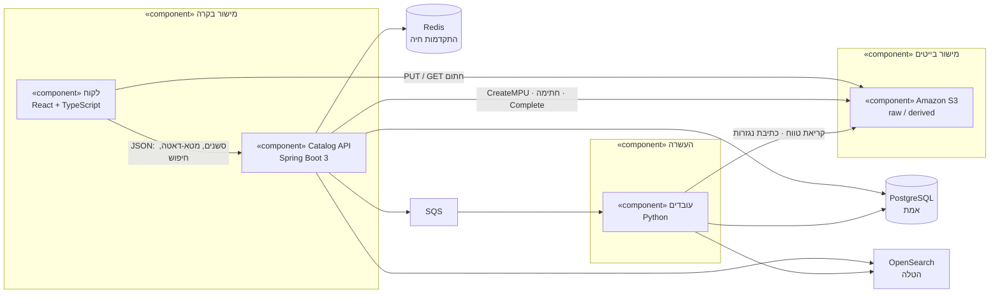
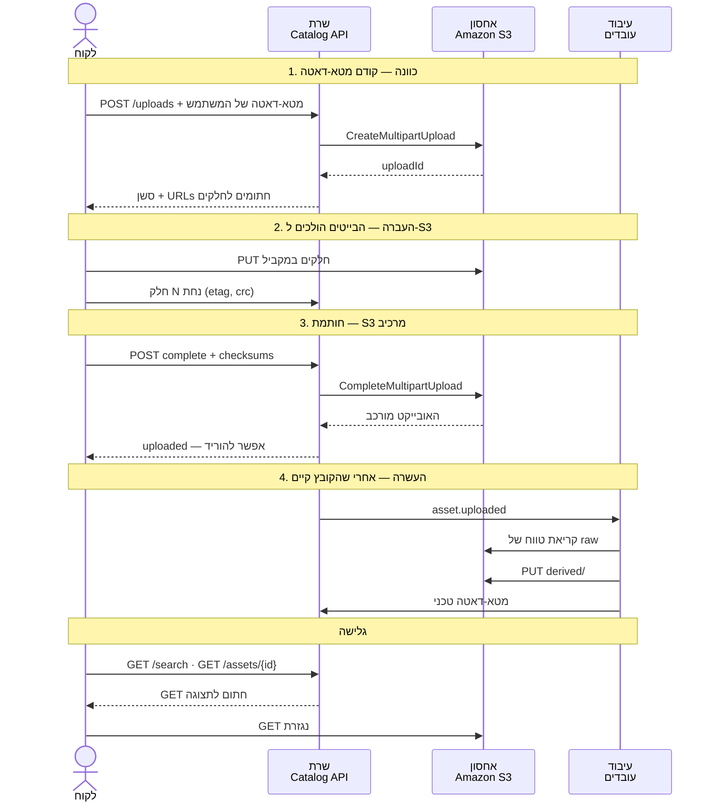
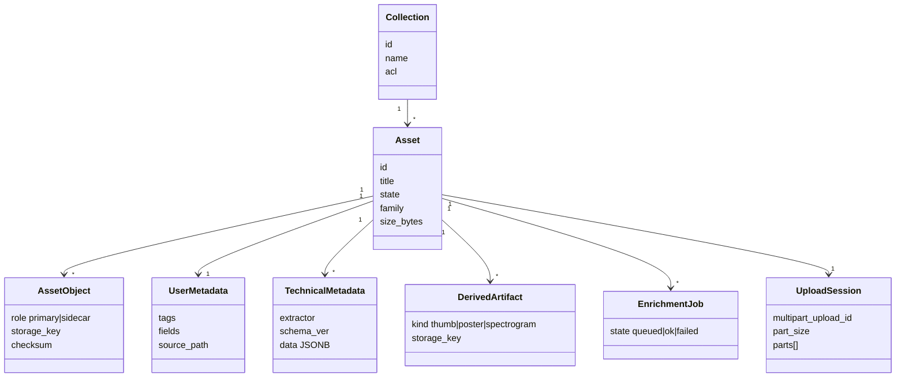
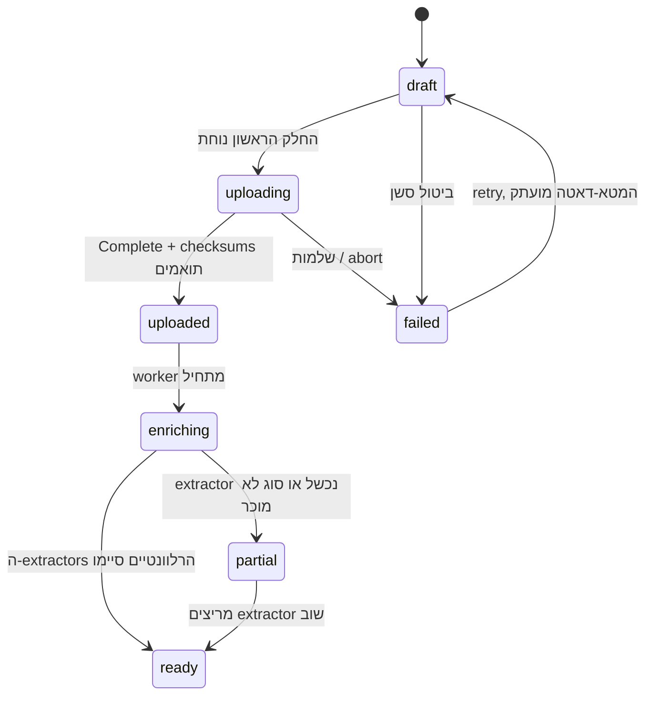

# UML ברמה גבוהה

מקור עברי לסקירת הארכיטקטורה. אנגלית: [`uml.md`](uml.md). דף אינטראקטיבי: [`../ui/uml.html`](../ui/uml.html) (EN / עב).

המטלה ביקשה סקירת ארכיטקטורה — רכיבים, איך הם מדברים, איפה הדאטה חי בכל שלב — וגם כלים והחלטות. זה הקובץ הזה.

## מה המערכת חייבת לעשות

- **העלאות טרה אמינות** — multipart חתום ל-Amazon S3. ה-API לא מעביר בייטים.
- **מטא-דאטה בהעלאה** — שדות המשתמש נשמרים ב-`draft`, לפני שהחלק הראשון נוחת.
- **העשרה איפה שאפשר** — עובדים אסינכרוניים כתוספים. סוג לא מוכר נשאר אזרח מלא.
- **גלישה לוגית** — אוספים ופילטרים, לא שחזור של מערכת קבצים.

---

## 1. דיאגרמת רכיבים

מישור הבקרה (לקוח + API) מדבר מטא-דאטה. מישור הבייטים (S3) מדבר קבצים. העובדים קוראים מ-S3 וכותבים משמעות חזרה ל-Postgres / OpenSearch.

| רכיב | מדבר עם | מה חי שם |
|---|---|---|
| **לקוח** | API (JSON), S3 (בייטים) | יומן resume ב-IndexedDB, מטא-דאטה בעריכה, חלקים בדרך |
| **Catalog API** | Postgres, Redis, SQS, OpenSearch, S3 (בקרה בלבד) | כלום דורבילי חוץ ממה שהוא כותב לחנויות |
| **Amazon S3** | לקוח, API, עובדים | אובייקטים גולמיים, חלקי multipart, תצוגות נגזרות |
| **PostgreSQL** | API, עובדים | assets, סשנים, ACL, מטא-דאטה של משתמש וטכני |
| **Redis** | API | התקדמות חיה. לא יומן ה-resume |
| **SQS** | API, עובדים | הודעות `asset.uploaded` |
| **עובדים** | S3, Postgres, OpenSearch, SQS | באפרי פענוח זמניים |
| **OpenSearch** | API, עובדים | מסמכי חיפוש שטוחים. אפשר לבנות מחדש |

---

## 2. דיאגרמת רצף — לקוח, שרת, עיבוד, אחסון

ארבעה שלבים, כמו שביקשו במטלה.

S3 שומר חלקים ומדביק אותם ב-Complete. הלקוח וה-API מנהלים את הסשן. S3 לא מריץ טרנזקציות SQL ולא מנהל וידאו.

---

## 3. דיאגרמת מחלקות — איפה הדאטה חי

- **Asset** הוא לוגי — מה שאנשים רואים.
- **AssetObject** הוא פיזי — מה ש-S3 מחזיק.
- **UserMetadata** הוא כוונה — נכתב ב-`POST /uploads`.
- **TechnicalMetadata** הוא תצפית — נכתב אחרי החותמת.

---

## 4. מכונת מצבים

הורדה מותרת מ-`uploaded` והלאה. העשרה לא מחביאה קובץ. `failed` הוא רק שלמות / סשן.

---

## 5. כלים

| שכבה | בחירה | למה |
|---|---|---|
| לקוח | React + TypeScript | תור העלאה ארוך ו-inspector |
| API | Java 21, Spring Boot 3 | קטלוג טרנזקציוני. מטא-דאטה, לא בייטים |
| עובדים | Python 3.12 | exif, ffprobe, Tika, SIGMF, GDAL |
| אחסון | Amazon S3 | multipart מובנה, checksums, lifecycle, 50 TB |
| אמת | PostgreSQL 16 | יחסים ומכונת מצבים אמיתית |
| חיפוש | OpenSearch | פילטרים. אפשר לבנות מחדש. לא האמת |
| תור | Amazon SQS | החותמת חייבת לשרוד קריסת worker |
| התקדמות | Redis | לוח לבן בלבד. היומן ב-Postgres |

---

## 6. החלטות שלא אהפוך

1. **מישור בקרה ≠ מישור בייטים.** בייטים לא עוברים ב-API.
2. **Asset ≠ object.** צילום SIGMF הוא שורת קטלוג אחת ושני blobs.
3. **העשרה היא best-effort.** במטלה כתוב “where possible”. unknown הוא טיפוס.
4. **גלישה היא קטלוג.** אוספים + פילטרים. הנתיב הישן הוא פילטר, לא המוצר.
