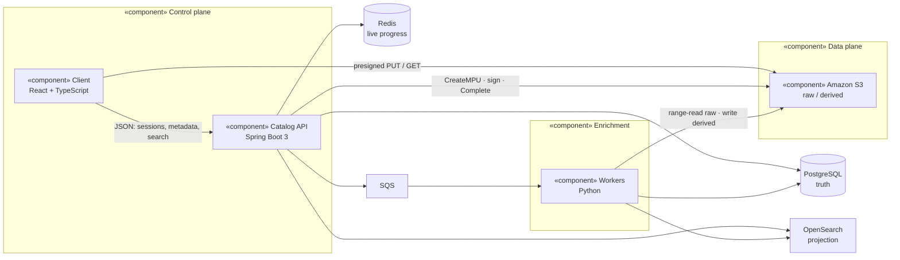
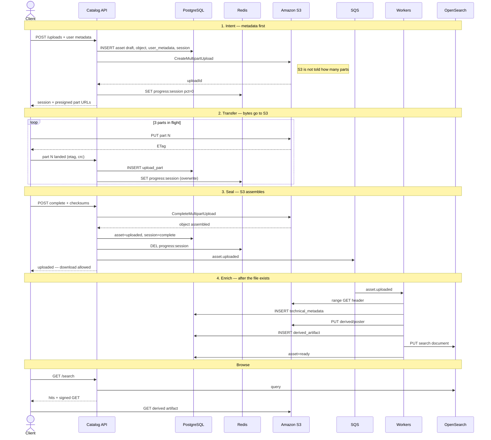
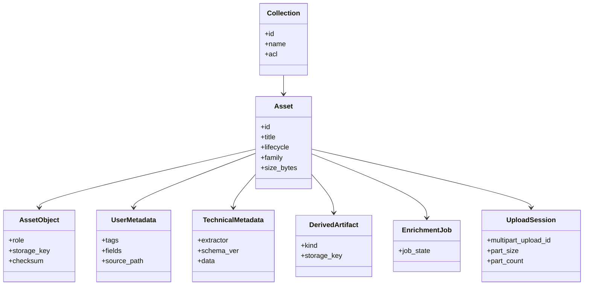
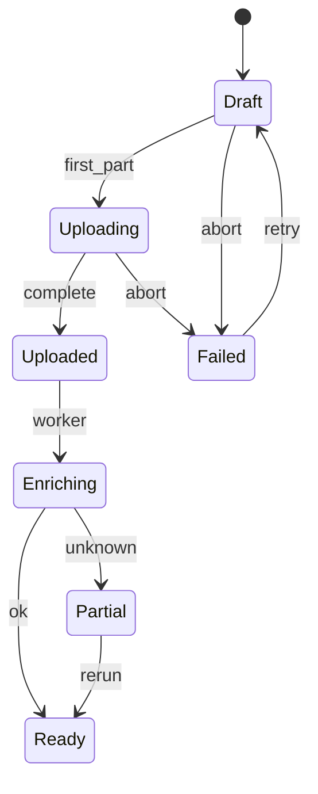

# High-level UML

Architecture overview. Interactive page: [`../ui/uml.html`](../ui/uml.html).

The assignment asked for an architecture overview — components, how they talk, where data lives at each stage — plus tools and key decisions. That is this file.

## What the system must do

- **Reliable TB uploads** — presigned multipart to Amazon S3. The API never carries file bytes.
- **Metadata at upload** — user fields are committed in `draft`, before the first part lands.
- **Enrich where possible** — async plugin workers. Unknown types stay first-class.
- **Logical browse** — collections and facets, not a reconstructed filesystem.

---

## 1. Component diagram

Control plane (client + API) talks metadata. Data plane (S3) talks bytes. Workers read S3 and write meaning back to Postgres / OpenSearch.

| Component | Talks to | Data that lives there |
|---|---|---|
| **Client** | API (JSON), S3 (bytes) | Resume journal in IndexedDB, metadata being edited, parts in flight |
| **Catalog API** | Postgres, Redis, SQS, OpenSearch, S3 (control only) | Nothing durable except what it writes to stores |
| **Amazon S3** | Client, API, workers | Raw objects, multipart parts, derived previews |
| **PostgreSQL** | API, workers | Assets, sessions, ACL, user metadata, technical metadata |
| **Redis** | API | Live progress. Not the resume ledger |
| **SQS** | API, workers | `asset.uploaded` messages |
| **Workers** | S3, Postgres, OpenSearch, SQS | Temporary decode buffers |
| **OpenSearch** | API, workers | Flattened search documents. Rebuildable |

---

## 2. Sequence diagram — client, server, processing, storage

Four stages, as the brief asked. Amber path in the HTML is metadata. Green path is bytes.

S3 stores parts and concatenates them on Complete. The client and API drive the session. S3 does not run SQL transactions and does not manage video.

---

## 3. Class diagram — where data lives

- **Asset** is logical — what people browse.
- **AssetObject** is physical — what S3 holds.
- **UserMetadata** is intent — written at `POST /uploads`.
- **TechnicalMetadata** is observation — written after seal.

---

## 4. State machine

Download is allowed from `uploaded` onward. Enrichment never hides the file. `failed` is integrity / session only.

---

## 5. Tools

| Layer | Choice | Why |
|---|---|---|
| Client | React + TypeScript | Long-lived upload queue and inspector |
| API | Java 21, Spring Boot 3 | Transactional catalog. Metadata, not bytes |
| Workers | Python 3.12 | exif, ffprobe, Tika, SIGMF, GDAL |
| Storage | Amazon S3 | Native multipart, checksums, lifecycle, 50 TB objects |
| Truth | PostgreSQL 16 | Relations and a real state machine |
| Search | OpenSearch | Facets. Rebuildable. Never truth |
| Queue | Amazon SQS | Seal must survive a worker crash |
| Progress | Redis | Whiteboard only. Ledger is Postgres |

---

## 6. Decisions I would not reverse

1. **Control plane ≠ data plane.** Bytes never go through the API.
2. **Asset ≠ object.** A SIGMF take is one catalog row and two blobs.
3. **Enrichment is best-effort.** The brief says “where possible”. Unknown is a type.
4. **Browse is a catalog.** Collections + facets. The old path is a filter, not the product.
